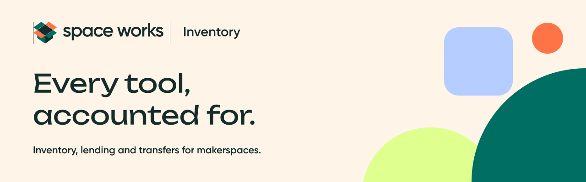
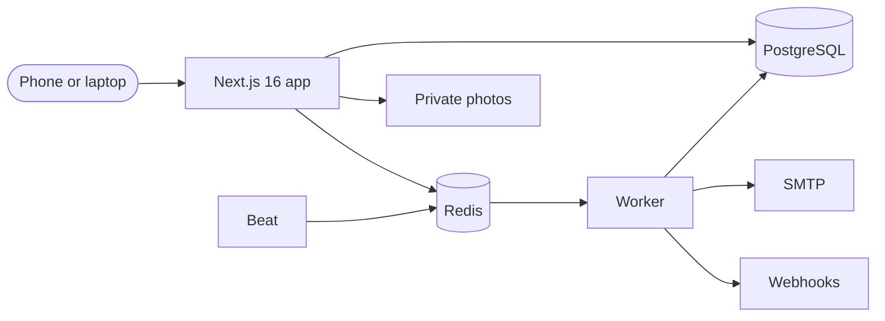

<picture>
  <source media="(prefers-color-scheme: dark)" srcset="docs/readme/banner-dark.png" />
  <source media="(prefers-color-scheme: light)" srcset="docs/readme/banner.png" />
  
</picture>

<p align="center">
  <a href="LICENSE"></a>
  <a href="https://nextjs.org"></a>
  <a href="docs/TESTING.md"></a>
  <a href="docs/DEPLOYMENT_VPS.md"></a>
</p>

<p align="center">
  <a href="#host-it-on-a-vps-in-one-line">Host on a VPS</a> ·
  <a href="#cloud-hosting">Cloud hosting</a> ·
  <a href="#quick-start-local">Quick start</a> ·
  <a href="docs/README.md">Documentation</a> ·
  <a href="CONTRIBUTING.md">Contributing</a>
</p>

**Space Works Inventory is the free, open-source, self-hosted stock room and
lending desk for makerspaces, tool libraries and fab labs.** Keep the
catalogue, shelves and bins in order, lend tools to members with a QR scan
and a photo at every handover, count stock, and move stock between rooms or
between makerspaces, all on infrastructure you control. One installation
runs several makerspaces, each with its own members, roles, settings and
audit trail.

It is fully standalone. Its REST API and signed webhooks let you connect it
to the other Space Works apps ([Events](https://github.com/SpaceWorks-HQ/SpaceWorks-Events),
[Workspace](https://github.com/SpaceWorks-HQ/SpaceWorks-Workspace),
[Organization](https://github.com/SpaceWorks-HQ/SpaceWorks-Organization)) or
anything else, whenever you want.

## What you can do

### Set up in minutes

- A first-run wizard: the instance admin, your first makerspace, then a
  guided setup for locations (building → room → shelf → bin), categories,
  units, your team's roles, lending and fees.
- Bulk import from CSV or Excel with a validated preview (locations,
  categories, items, stock and assets), templates to start from, and a
  realistic sample inventory to explore with.

### Catalogue and stock

- Quantity-tracked items (resistors, filament) and serialized assets (each
  drill with its own tag and history), with photos, suppliers, costs and
  per-item lending rules.
- QR labels for items, assets, shelves, kits and containers: print sheets as
  PDF in three label sizes. Scan with any phone camera.
- Receipts, adjustments with a reason, moves between shelves, a repair shelf
  for damaged units, and an append-only stock ledger.
- Cycle counts (blind if you like) by location or category, scheduled or ad
  hoc, with stale-line detection and four-eyes posting above a threshold.
- Low-stock alerts at reorder points, a "to buy" list from suggestion to
  received stock, and stock valuation at weighted average cost.

### Transfers

- Move stock between locations of a space or between makerspaces of the same
  installation: request → approve → pick and dispatch with QR scans → in
  transit → receive, in one go or in parts.
- Damaged units go to the repair shelf, missing units are declared with a
  note, refused units return to the sender. Stock stays correct while it is
  on the road, and both spaces see the full timeline.

### Lending

- A member catalogue (and an optional public one) with availability and fees
  in plain words; requests, staff approval, renewals and self-checkout.
- Every issue and return needs the QR scans, photos and remarks; containers
  and kits keep bundles together.
- Overdue reminders and escalation; lost or damaged items open incidents
  that can restrict a member's borrowing until they are resolved.
- **Free or paid, your choice:** refundable deposits, rental per day, week or
  flat, late fees with grace and caps, damage and loss charges, each
  overridable per category and item. Members pay with **Razorpay** or
  **Stripe**, staff record **cash or bank** payments, or members choose
  **pay later**. Deposits are refunded in full or in part with a reason, and
  fees can be waived.

### Run it your way

- Space-manager settings for the whole makerspace (lending policy, member
  eligibility, evidence rules, fees, payment providers, notifications,
  branding) and inventory-manager settings for the stock side (categories,
  units, thresholds, transfer approvals, labels, count schedules). Every
  change is audited.
- Roles: Owner, Admin, Inventory manager, Staff and Member
  ([role matrix](docs/RBAC.md)).
- Reports with CSV and Excel exports, an audit log, email and in-app
  notifications, signed outbound webhooks and a REST API with API keys
  ([API guide](docs/API.md)).
- Email and password, emailed magic links and authenticator-app MFA.

## A look around

Captured from the seeded demo with `npm run readme:screens`, in light and dark mode.

<!-- screenshots -->

## Host it on a VPS in one line

The complete application runs on your own Linux server: a **backend** image
(the app and API, which also runs migrations, the worker and beat) and a
**frontend** image (the website), with PostgreSQL 16, Redis 7, private
[Silo](https://github.com/pgsty/silo) object storage for photos and Caddy for
automatic HTTPS.

On a 64-bit Linux server (Ubuntu/Debian, Fedora/RHEL/Alma/Rocky, Arch or
openSUSE), as root or a user with `sudo`:

```bash
curl -fsSL https://raw.githubusercontent.com/SpaceWorks-HQ/SpaceWorks-Inventory/main/install.sh | bash
```

While the repository is private, give the installer a GitHub token that can
read the repository and its packages (it downloads the release and logs in
to GitHub Packages with it):

```bash
export SWI_GITHUB_TOKEN=<token> SWI_GITHUB_USER=<your-github-username>
curl -fsSL -H "Authorization: Bearer $SWI_GITHUB_TOKEN" https://raw.githubusercontent.com/SpaceWorks-HQ/SpaceWorks-Inventory/main/install.sh | bash
```

It checks the server, asks every question first (layout and hostnames, the
admin email, HTTPS, storage, SMTP, backups, automatic deploys), shows one
summary and changes nothing until you confirm. Then it installs Docker if
needed, generates every secret, downloads the release images, migrates and
checks each service. Nothing is compiled on your server.

Run the same command again for the menu: **update** (with automatic rollback),
**back up now**, **status**, **backup schedule** (encrypted, off-site
copies), **change settings**, **server security**, **automatic deploys**,
**recover admin access**, **support bundle** and **uninstall**. The
[VPS guide](docs/DEPLOYMENT_VPS.md) covers manual installs, restores and
monitoring. You need 2 vCPU, 2 GB RAM, 30 GB disk, DNS records for your
hostnames, ports 80 and 443 and an SMTP relay. Phone cameras need HTTPS to
scan QR codes.

## Cloud hosting

[](https://render.com/deploy?repo=https://github.com/SpaceWorks-HQ/SpaceWorks-Inventory)

The [Render Blueprint](render.yaml) runs the web service, worker and beat
with managed PostgreSQL (for example Supabase), Redis (Upstash), private
object storage (Cloudflare R2) and SMTP (Brevo). On the free plan, run the
web service alone and let the [Cloudflare cron Worker](deploy/cloudflare-cron/README.md)
deliver email and reminders every minute. A private repository must be
connected to Render through GitHub first. DigitalOcean App Platform works
with [`.do/app.yaml`](.do/app.yaml); any Docker host works with the two
images ([Docker guide](docs/DEPLOYMENT_DOCKER.md)). The
[cloud guide](docs/DEPLOYMENT_CLOUD.md) walks through every value.



## Quick start (local)

Use Node.js 22 and PostgreSQL 16 (the development Compose file provides
PostgreSQL, Redis, Silo and Mailpit).

```bash
npm ci
cp .env.example .env
docker compose up -d
npm run db:deploy
DEMO_PASSWORD='choose-12-or-more-characters' npm run db:seed:demo
npm run dev
```

Open http://localhost:3000 and sign in as `anjali@tinkerspace.test` (owner),
`meera@tinkerspace.test` (inventory manager), `joel@tinkerspace.test`
(staff) or `fathima@tinkerspace.test` (member) with your demo password. To
try the first-run wizard instead, skip the seed and open `/setup`. Without
SMTP, development emails (magic links, invitations) are written to
`.data/mail/`.

## Design system

Built on the [Space Works design system](https://spaceworks-hq.github.io/SpaceWorks-Design/):
Gilroy, flat cards, teal actions, a Citron sidebar, status pills that always
carry a word, and light and dark mode throughout.

| | Colour | Used for |
| --- | --- | --- |
|  | Deep Ink | Text and dark surfaces |
|  | Warm Cream | Canvas and inverse labels |
|  | Maker Teal | Actions, links and focus |
|  | Workshop Orange | Accent fill with an ink label |
|  | Citron | Sidebar and selection |
|  | Sky Blue | Information |
|  | Warm Yellow | Warnings |

See [the design guide](docs/DESIGN.md). Regenerate the banner with
`npm run readme:art`.

## Documentation

| Read this | When you want to |
| --- | --- |
| [Documentation index](docs/README.md) | Find every guide |
| [Architecture](docs/ARCHITECTURE.md) | Understand tenancy, stock buckets, flows and background work |
| [Invariants](docs/INVARIANTS.md) | Know the rules every change must keep |
| [Roles](docs/RBAC.md) | See who can do what |
| [Configuration](docs/CONFIGURATION.md) | Look up settings and secrets |
| [VPS deployment](docs/DEPLOYMENT_VPS.md) | Install, update, back up and recover |
| [Cloud deployment](docs/DEPLOYMENT_CLOUD.md) | Use Render, managed services and free plans |
| [API](docs/API.md) | Integrate with API keys and webhooks |
| [Testing](docs/TESTING.md) | Run the checks |

## Contributing

Read [CONTRIBUTING.md](CONTRIBUTING.md) and [AGENTS.md](AGENTS.md) first.
Work branches from `dev`; `main` is production and only the maintainer merges
to it. Keep stock changes in the availability module, state changes in the
workflow modules, and tenant and role checks on the server.

## Credits

Made by **Space Works**, a maker community that started inside TinkerSpace
Kochi, and ported from the original Space Works makerspace manager. Licensed
[AGPL-3.0-or-later](LICENSE): if you modify and host it, offer the matching
source to the people using your version.

## Project status

In active development: a standalone app split out of [SpaceWorks](https://github.com/SpaceWorks-HQ/SpaceWorks), part of the [SpaceWorks-HQ](https://github.com/SpaceWorks-HQ) family. See [`docs/HANDOFF.md`](docs/HANDOFF.md) for what is done, what is in progress and how to continue.
